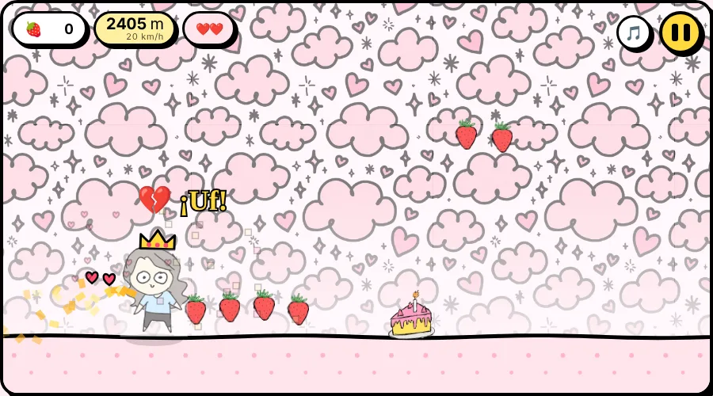
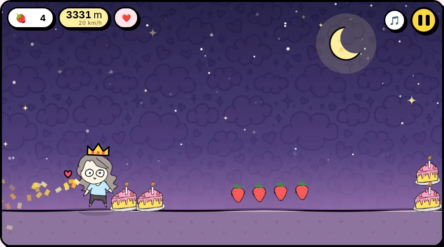
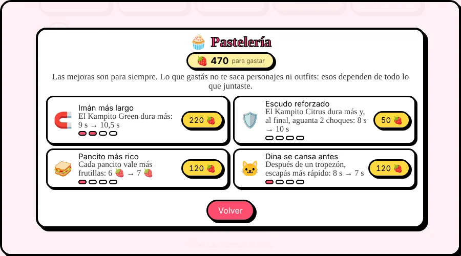
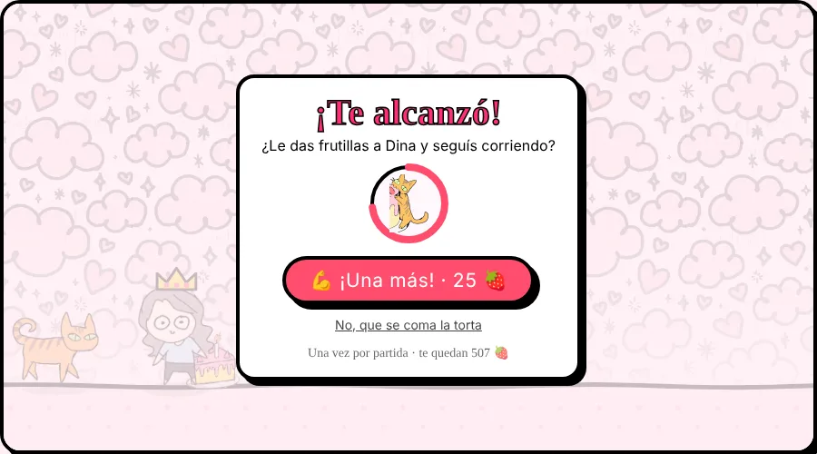
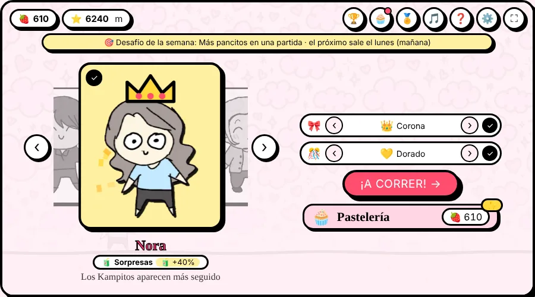

# Sofi Runner 🍓🏃‍♀️

Un *infinite runner* de un solo toque, con dibujos de Sofía. Corrés, juntás frutillas, esquivás porciones de torta, elegís dulces en el camino y gastás lo que juntaste en personajes, cosméticos y mejoras para llegar cada vez más lejos. Si chocás… Dina te persigue.

Nació de [Torta Runner](https://github.com/LeandroACasco/torta-runner), el juego de cumpleaños que hicimos en familia. Esta versión es para cualquiera que quiera jugarlo.

**▶ Jugar:** https://LeandroACasco.github.io/sofi-runner/

## Cómo se juega

La primera vez hay una carrera de práctica corta: un dedito te muestra cuándo saltar y cuándo hacer el doble salto, y después vienen el pancito y un Kampito.

- **Saltar:** tocá la pantalla o hacé clic. En la computadora también sirven Espacio, ↑ o W.
- **Doble salto:** saltá de nuevo en el aire.
- **Pausa:** botón ⏸, o P / Esc. Al volver hay una cuenta 3-2-1.
- **Música:** botón 🎵, o la tecla M.

Si chocás una torta, tropezás y **Dina** sale a correrte. Si volvés a chocar antes de que se canse, te alcanza.

## 🍭 Los dulces

Cada 1000 m cambia el día y la noche: de día el cielo rosa con las nubes de Sofía, y de noche estrellas y luna. Al caer la primera noche, y después en cada amanecer (hasta 8 veces por partida), el juego se frena y te ofrece 3 dulces para elegir uno (con un toque, o las teclas 1, 2 y 3). Te ayudan hasta que termina la partida y se pueden juntar, así cada partida sale distinta.

| Dulce | Qué hace |
| --- | --- |
| 🍭 Triple salto | Un salto más en el aire |
| ⏳ Kampito eterno | Los poderes duran 50% más (hasta 2 veces) |
| 🧃 Kampitos por doquier | Aparecen el doble de Kampitos |
| ❤️ Corazón extra | Un corazón más (hasta 3) |
| 🥪 Tortas de pancito | Algunas tortas se vuelven pancitos (hasta 2 veces) |
| 😴 Dina dormilona | Dina se cansa el doble de rápido |
| 🧲 Imancito | Atraés las frutillas cercanas, siempre (hasta 2 veces) |
| 🥖 Pancito doble | Los pancitos valen el doble |
| 🛡️ Escudo ya | Un escudo en el momento |
| 🌶️ Picante | Todo vale el doble… pero vas mucho más rápido |
| 🍵 Manzanilla | Bajás un poco la velocidad (hasta 2 veces) |
| 🎈 Saltos de globo | Saltás más alto y caés más lento |

### ❤️ Corazones y 🛡️ escudo

- **Escudo:** la burbuja azul del Kampito Citrus. Dura unos segundos y rompe la torta que toques. Con la mejora al máximo aguanta dos choques: se ve con dos anillos y el marcador dice 🛡️×2.
- **Corazones:** se guardan hasta que chocás, sin vencerse. Se ven en el marcador y al costado de tu personaje. Cada choque gasta uno en vez de hacerte tropezar.

## 📈 Cada vez más difícil

- La velocidad sube rápido al principio y después sigue subiendo despacio, sin tope cercano.
- Con la distancia aparecen tortas dobles, **torres** (dos tortas apiladas: hace falta doble salto) y **tríos**, y el espacio entre tortas se achica.
- Tropezar te frena un momento, pero en 2 segundos recuperás la velocidad.
- **Dina se enoja:** cada tropezón de la partida la hace tardar un segundo más en cansarse.

## 🎃 Temas de temporada

En ciertas fechas el juego se viste solo. El primero es **Halloween** (del 15/10 al 2/11): murciélagos, calabazas, luna naranja y tortas con sombrero de bruja. Trae cosméticos que solo se compran en esa temporada (y después quedan para siempre): el sombrero de bruja y el confeti calabaza. Se puede apagar en ⚙️ *Temas de temporada*.

## Las frutillas

Cada frutilla que juntás cuenta dos veces:

- **Para siempre:** el total que juntaste en tu vida. Ese número nunca baja y cuenta para los logros.
- **Para gastar:** el mismo total, menos lo que ya gastaste en personajes, cosméticos y mejoras. Es lo que se ve arriba a la izquierda del menú.

### 🧁 La Pastelería

Cuatro mejoras para siempre, cada una con 4 niveles (50, 120, 220 y 350 🍓):

| Mejora | Qué hace | Nivel 0 → nivel 4 |
| --- | --- | --- |
| 🧲 Imán más largo | El Kampito Green dura más | 6 s → 12 s |
| 🛡️ Escudo reforzado | El Kampito Citrus dura más y, al máximo, aguanta 2 choques | 8 s → 14 s y 2 choques |
| 🥪 Pancito más rico | Cada pancito vale más | 5 → 10 🍓 |
| 🐱 Dina se cansa antes | Después de un tropezón, escapás más rápido | 9 s → 5 s |

### 💪 ¡Una más!

Cuando Dina te alcanza, podés darle frutillas y seguir corriendo, una vez por partida. Cuesta 25 🍓 y sube 5 cada 100 m que hayas corrido, hasta 100. Se paga con lo que tenés para gastar más lo que juntaste en esa partida. Si no tocás nada en 6 segundos, Dina se come la torta.

## Las comiditas

- **Pancito con salame 🥪:** vale 5 frutillas (más con la Pastelería).
- **Kampito 🧃:** en sus 3 sabores, cada uno con su poder por unos segundos:
  - 🟢 **Green** → 🧲 **Imán:** las frutillas y los pancitos cercanos vuelan hacia vos.
  - 🟡 **Tropical** → ✖️2 **Frutillas dobles:** todo vale el doble.
  - 🟠 **Citrus** → 🛡️ **Escudo:** la próxima torta que te toque se rompe en migas. También espanta a Dina.

## Los personajes

Sofi está desde el inicio y los demás se compran a 500 🍓 cada uno. Cada personaje tiene su habilidad, y ninguna cambia la velocidad, así los récords se comparan parejo:

| Personaje | Habilidad |
| --- | --- |
| Sofi | 🏃 **Escurridiza:** Dina se cansa 2 s antes |
| Deisy | 🌟 **Saltarina:** salta más alto |
| Leandro | 💘 **Corazón imán:** atrae las frutillas cercanas, siempre |
| Nora | 🧃 **Sorpresas:** los Kampitos aparecen más seguido |
| Cinthia | ❤️ **Fiestera:** arranca cada partida con un corazón |

En el menú, tu personaje va al centro y los demás en un carrusel: con las flechas, deslizando o tocando uno de los costados ves sus habilidades y los comprás.

### 🎀 Cosméticos

Al lado del carrusel hay dos filas con flechitas: **accesorio** y **confeti**. Cuando pasás por uno que no tenés, se ve puesto en tu personaje antes de comprarlo.

| Accesorio | 🍓 |
| --- | --- |
| 💘 Corazón flotante | 150 |
| 💖 Hoodie rosa (solo Sofi) | 200 |
| 👑 Corona | 300 |

| Confeti (te sigue al correr) | 🍓 |
| --- | --- |
| 💗 Rosa | 120 |
| 💚 Menta | 150 |
| 💙 Cielo | 150 |
| 💛 Dorado | 200 |
| 🌈 Arcoíris | 250 |

## Logros, desafío y ranking

- **🏅 22 logros**, desde *Primera carrera* hasta *Golosa* (3 dulces en una partida). En la misma pantalla, 📊 *Mis números* muestra tus estadísticas.
- **🎯 Desafío de la semana:** cambia todos los lunes.
- **🏆 Ranking:** por ahora es el de cada dispositivo (varias personas pueden anotarse en el mismo).

Todo el progreso se guarda en el dispositivo donde jugás.

## Jugar en el celular como app

El juego se puede instalar y jugar sin internet una vez abierto.

- **Android (Chrome):** menú ⋮ → *Agregar a la pantalla principal*.
- **iPhone (Safari):** botón Compartir → *Agregar a inicio*.

## Créditos

| Qué | Quién |
| --- | --- |
| Dibujos, personajes y animación | **Sofía** 🎨 |
| Idea y producción | Leandro |
| Programación | Leandro, con asistencia de IA (Claude) |
| Música | Melodía original tipo cajita musical |
| Tipografías | [Caveat](https://fonts.google.com/specimen/Caveat) y [Fredoka](https://fonts.google.com/specimen/Fredoka) (Google Fonts, licencia OFL) |

## Licencia

- **Código:** MIT (ver [LICENSE](LICENSE)).
- **Dibujos y animación** (todo lo que está en `assets/` y `docs/`): © Sofía. Todos los derechos reservados. No se pueden copiar ni reutilizar sin su permiso.
